## 1. Task and headline result

We predict, for every driver in a race, whether he finishes on the podium (`positionOrder ≤ 3`), using only information available **after qualifying and before the start**. The data is the Kaggle/Ergast Formula 1 dataset (version 24, 1950–2024, 14 relational tables). All numbers and figures in this report come from the run-all notebook `notebooks/f1_podium_prediction.ipynb`.

| | |
|---|---|
| **Grain** | one row per (raceId, driverId): 24,586 race starts, 1950–2024 |
| **Split** | train 1981–2019 · validation 2020–2021 · test 2022–2024 (chronological) |
| **Final model** | tuned logistic regression on 20 leakage-safe features |
| **Test (2022–2024)** | **PR-AUC 0.722** (primary) · **F1 0.669** (secondary) · ROC-AUC 0.937 · top-3 precision 0.662 |
| **Reference rule** | "top 3 on the grid finish on the podium": PR-AUC 0.647 · F1 0.649 |

## 2. Data cleaning and auditing

All cleaning works on copies; the raw CSVs are never modified. Every rule below is backed by a computed audit in the notebook (sections 2–4).

- **Sentinels.**
  - 30 columns in 6 tables contain the literal `\N`, 160,076 cells in total. `q2`/`q3` additionally use *empty* fields for missing values.
  - Both encodings become `NaN`/`NaT`. No `\N` remains after cleaning.
- **Semantic typing.**
  - 12 numeric columns were stored as text, along with 7 date columns, 7 clock times and 7 durations.
  - Dates become datetimes, and race date + time become one UTC timestamp.
  - Durations (`m:ss.sss`) become numeric seconds. The parser was verified against the `milliseconds` columns: the maximum difference is 0.0000 s over 589,081 laps and 11,371 pit stops.
- **Additional issues found.**
  - One impossible qualifying lap: 1995 Japanese GP Q1 = 16:42.640, 10× the pole time. Laps more than 2× the session's fastest time are set to missing.
  - Trailing whitespace in nationalities (`"Argentinian "`).
  - Circuit country written both `USA` and `United States`.
  - 10 qualifying rows with a different constructor than the result row. We use the result's constructor, since that is the car that started.
- **Keys.** All 14 primary keys and 6 natural keys are unique and non-null, and all 27 foreign-key and cross-table checks reconcile. The **only** failure is the modeling grain: `results (raceId, driverId)` has 91 extra rows in 85 pairs.
- **Duplicates (shared drives, 1950–1964 plus one 1978 non-qualifier).** Each duplicate row carries the grid slot of *its car*, so:
  - the "non-zero grid" rule decides **none** of the 85 pairs;
  - the "best positionOrder" rule would give 64 drivers the grid slot of a car they did not start in, which is post-start information.
- **Our duplicate rule.** We keep the driver's first entry (lowest `resultId`), which is the car he started in. We verified this on documented cases: Moss and Brooks in the 1957 British GP, Fangio in the 1956 Italian GP, and Moss in the 1960 Argentine GP. The label is "podium in any car", because officially these drivers are credited with that result; using only the started car's position would lose 16 credited podiums.
- **Modeling population.**
  - We remove the **Indianapolis 500**, identified by race name: only 4% of its 107 drivers ever entered another championship race.
  - We remove **non-starters**: `F` (failed to qualify) and `W` (withdrawn).
  - Before 1994, `grid = 0` almost always marked a non-starter. The remaining 87 `grid = 0` rows are pit-lane starts and are placed one slot behind the last car, with a flag.

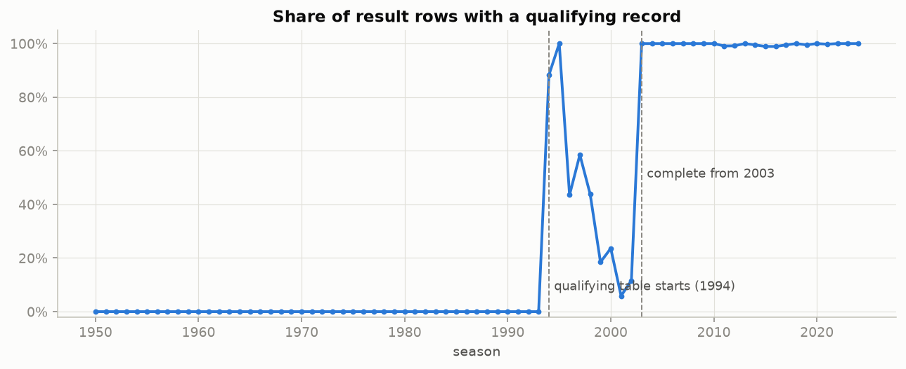

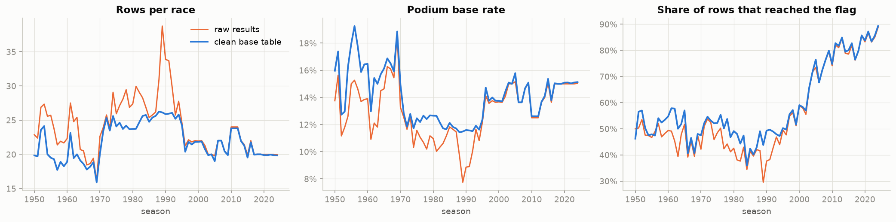

## 3. Data-engineering questions

### Q1. Front-row conversion by circuit, before and after 2014

**Joins:** `results → races → circuits`, plus `qualifying`.

- **Front-row start:** `grid ∈ {1, 2}`, the actual start after penalties.
- **Conversion:** podiums ÷ front-row starts.
- **Ranking:** circuits with at least 10 front-row starts in both periods (16 circuits).

**Answer.**

- **A front-row start became far more valuable:** 56.6% conversion in 1950–2013 against **76.2%** in 2014–2024.
- **Best converters in 2014–2024:** Monaco (89%), Suzuka (89%) and Yas Marina (86%).
- **Worst:** the Hungaroring (59%) and Mexico City (61%).
- **The ranking changes almost completely** (Spearman ρ = −0.08, p = 0.76). Monaco went from 15th to 1st; the Hungaroring from 2nd to last.
- **Interpretation:** before 2014 conversion was driven by reliability; since 2014 it reflects how hard overtaking is.

**Qualifying vs grid** (2003–2024, full coverage). In 2014–2024, 6.0% of front-row qualifiers did not start on the front row because of penalties, and they converted only 33%, against 77% for drivers who qualified *and* started there. The grid is the right definition of a "front-row start". The qualifying-based ranking is similar (ρ = 0.90).

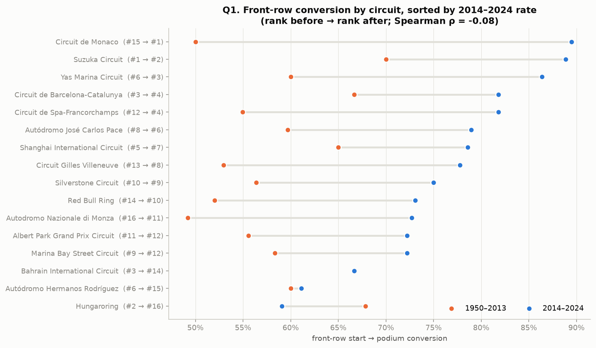

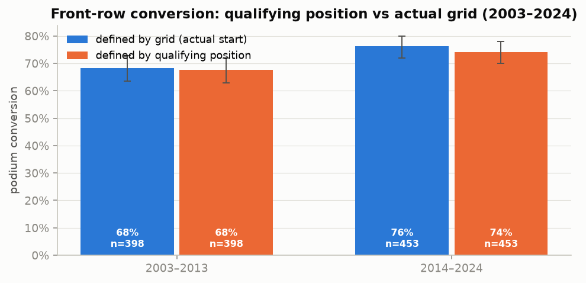

### Q2. Home advantage, controlled for starting position

**Joins:** `results → drivers` for nationality, and `results → races → circuits` for country. Every nationality is mapped by an asserted demonym-to-country table.

**Method:** Mantel–Haenszel pooled odds ratio within grid-position bands, with 95% CIs and CMH tests.

**Answer: no measurable home advantage once starting position is held fixed.**

| analysis | odds ratio (95% CI) | p |
|---|---|---|
| naive (no control) | 0.84 | – |
| within grid band | 0.96 (0.81–1.15) | 0.71 |
| same driver, same grid band | **1.00 (0.82–1.21)** | 0.97 |
| same driver, same grid band, 2003–2024 | 0.78 (0.51–1.21) | 0.32 |

- **The naive effect is even negative.** Home races attract one-off local entrants who start at the back: 50.6% of home rows start P13 or worse, against 45.5% of away rows.
- **This is an association, not a causal estimate.**

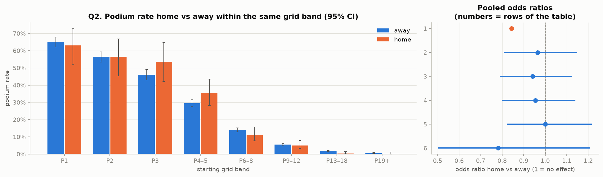

### Q3. Mechanical-retirement rate by constructor, 2014–2021 vs 2022–2024

**Definitions.**

- Denominator: race starts.
- Numerator: starts whose status is a car-component failure.
- All 139 status values are mapped explicitly into finished / mechanical / ambiguous / accident / operational / regulation / health. An assertion fails if any status is left unmapped.
- **Robustness:** a *broad* definition adds the ambiguous statuses (`Retired`, `Wheel`, `Tyre`, …).

**Answer.**

| period | highest rates (strict) | field-wide |
|---|---|---|
| 2014–2021 | Lotus F1 17.3%, Toro Rosso 16.1%, Renault 13.1%, McLaren 13.0% | 8.9% |
| 2022–2024 | Alfa Romeo 12.5%, Alpine 10.4%, AlphaTauri 6.8% | 5.5% |

- **2014–2021:** the immature Renault and Honda hybrid power units dominate the list. Mercedes (3.8%) and Ferrari (4.7%) were the most reliable.
- **Strict vs broad:** the ranking is stable for 2014–2021 (Spearman 0.95). It is less stable for 2022–2024 (0.68), where teams sit within overlapping confidence intervals.
- **Renamed teams** are separate `constructorId`s. A lineage view follows each organisation across both periods.

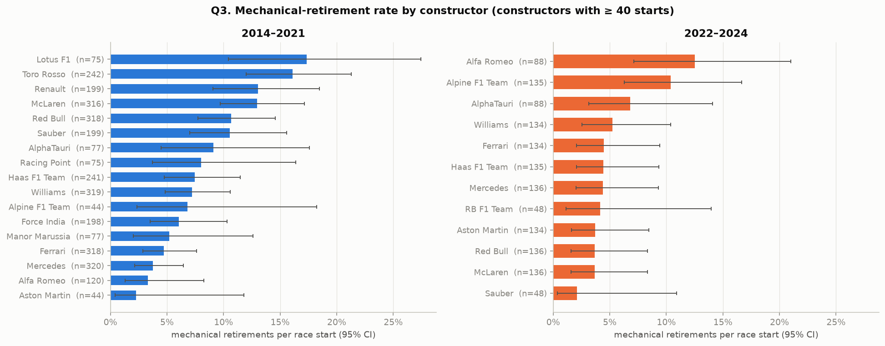

## 4. Features and why each is valid at the pre-race cutoff

Every *form* feature uses `groupby(...).shift(1)`, so it covers only earlier races. This was verified by a brute-force recomputation on 200 random rows. *Standings* features come from the table after the **previous round** of the same season. The unshifted standings would be leakage: they reach AUC 0.937 against 0.855 for ours, and a perfect 1.000 in round 1.

| group | features | why valid before the start |
|---|---|---|
| grid | `grid_pos`, `front_row`, `pit_lane_start` | the grid is fixed before the start (penalties applied) |
| qualifying | `quali_pos`, `quali_gap_pct` (gap to pole), `grid_vs_quali` (penalty size) | qualifying ends before the race |
| driver form | podium rate and average finish over the last 5 starts, DNF rate over the last 10, career podium rate, career starts | computed only from the driver's previous races |
| constructor form | team podium rate and average finish over the last 5 races, mechanical-DNF rate over the last 10 | computed only from the team's previous races |
| standings | championship position, points share of the leader and wins, for driver and team, **before** this race | taken from standings after the previous round |
| context | `field_size` | number of cars on the grid, known once the grid is set |

**Evidence (training seasons only).**

- Univariate AUCs: `quali_pos` 0.91, `grid_pos` 0.88, championship positions 0.83–0.84, constructor form 0.83, driver form 0.79–0.81.
- All of these features are monotone in the decile plots.
- **Excluded on evidence:** `home_race` (Q2, and re-checked: adding it changes test PR-AUC by +0.0001), sprint results (only from 2021, so absent from training), and `year` (the model would have to extrapolate).

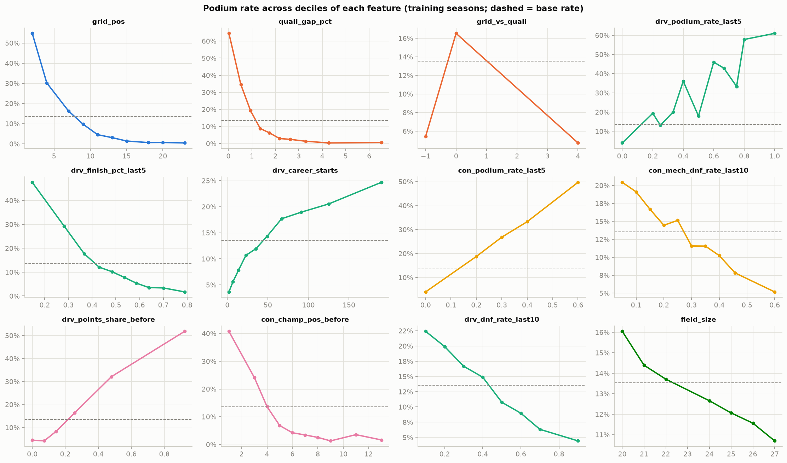

## 5. Split and preprocessing

- **Chronological split:** train ≤ 2019, validation 2020–2021, test 2022–2024.
  - It mirrors real use and keeps races and seasons intact.
  - The test seasons are a genuine regime change (the 2022 rules).
  - All choices (training window, hyperparameters, thresholds, model) use validation only.
- **Training window.** Chosen by experiment from {1950, 1981, 1994, 2003, 2010}. **1981–2019** is best, though within noise of the other long windows; 2010–2019 is clearly worse because it has too little data.
- **Preprocessing:** median imputation with missing-indicator columns, then standardisation. It sits inside the model `Pipeline`, so it is fitted on training rows only.
- **Preprocessing-order experiment 1, fit before vs after the split:** almost no difference here (test PR-AUC 0.7216 vs 0.7218), even though the means shift by up to 0.15 SD. We still enforce the correct order.
- **Preprocessing-order experiment 2, oversample before vs after the split:**
  - Oversampling *before* the split reports a fake validation PR-AUC of **0.93**; on the real validation races the same model scores 0.73.
  - Even oversampling *after* the split is worse than none (0.731 vs 0.738) and doubles the predicted probabilities.
  - So we do not resample; the threshold is tuned instead.

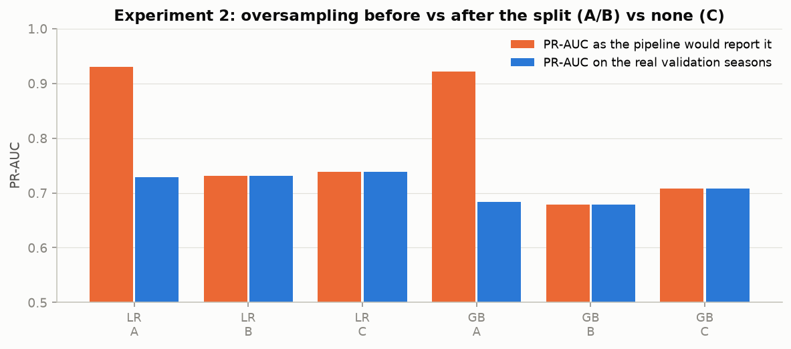

## 6. Models and comparison

The models below use the same rows, features and preprocessing. Hyperparameters were chosen by validation PR-AUC from 8 logistic-regression, 9 random-forest, 24 gradient-boosting and 12 network configurations. Each model's threshold maximises F1 on validation.

- **Primary metric, PR-AUC:** the positive class is rare (about 15%), and PR-AUC is not inflated by easy negatives.
- **Secondary metric, F1:** the quality of the actual yes/no decision.

| model | val PR-AUC | test PR-AUC | test ROC-AUC | test F1 | test precision | test recall | test top-3 prec. |
|---|---|---|---|---|---|---|---|
| reference: grid ≤ 3 | 0.648 | 0.647 | 0.913 | 0.649 | 0.650 | 0.647 | 0.652 |
| logistic regression (baseline) | 0.738 | 0.722 | 0.937 | 0.669 | 0.543 | 0.873 | 0.662 |
| **logistic regression (tuned, final)** | **0.738** | **0.722** | **0.937** | **0.669** | 0.543 | 0.873 | 0.662 |
| random forest | 0.723 | 0.717 | 0.940 | 0.667 | 0.543 | 0.863 | 0.632 |
| gradient boosting | 0.717 | 0.708 | 0.938 | 0.689 | 0.673 | 0.706 | 0.652 |
| shallow NN (MLP 64→32) | 0.747* | 0.715 | 0.933 | 0.672 | 0.575 | 0.809 | 0.637 |

\* single seed; the 5-seed mean is 0.730 ± 0.019. The network was therefore selected on its mean, and the tuned logistic regression became the final model. Train-set scores are in the notebook.

- **Learned models vs the rule.** A race-level bootstrap gives 95% intervals of about ±0.06 on test PR-AUC. **All learned models beat the rule** (0 of 1,000 bootstrap samples favour the rule) but are **indistinguishable from each other**: the flexible models beat the baseline in only 15–33% of samples.
- **The models are well calibrated.**
- **Best and worst test seasons:** 2023 is the easiest (PR-AUC 0.787, Red Bull's dominant year) and 2024 the hardest (0.667).

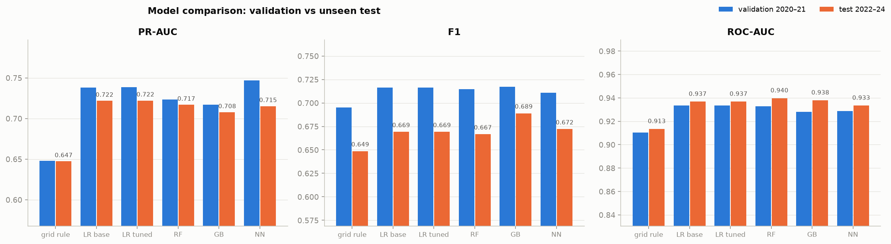

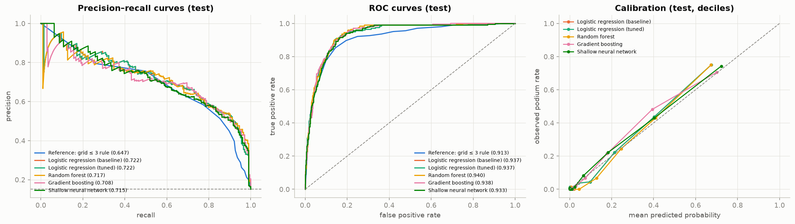

## 7. Feature-group ablation

We removed one group at a time and retrained the final model, with gradient boosting as a second opinion.

- **Starting position (grid + qualifying together) is the backbone:** removing it costs −0.15 test PR-AUC for logistic regression and −0.14 for gradient boosting.
- **Removing grid or qualifying alone** costs only about −0.02, because the two are 98% correlated.
- **Driver form, constructor form and standings each add a little** (up to about −0.02), and they substitute for one another because all of them encode "fast car this season".
- **`field_size` adds nothing.**

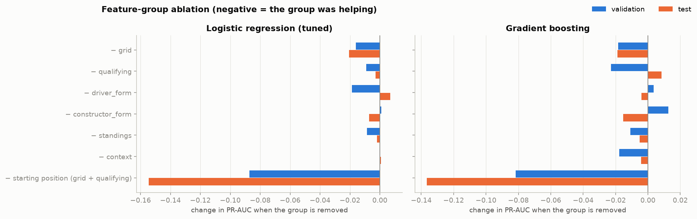

## 8. Explainability

> **Importance is not causation.** These methods show what the *model relies on* to predict, not what *causes* podiums. For example, team form is important because fast cars stay fast, not because past podiums make a car faster. Correlated features also share and swap importance.

- **Global, permutation importance (validation).**
  - `grid_pos` dominates: shuffling it costs 0.20 PR-AUC.
  - Grouped: grid 0.245 ≫ driver form 0.058 > qualifying 0.038 > standings 0.029 > constructor form 0.006 > context ≈ 0.
- **Global, SHAP** (permutation explainer on the full pipeline, background from 2003–2019 rows).
  - The order is `grid_pos`, then car strength (`con_finish_pct_last5`, `con_points_share_before`), then qualifying and driver form.
  - All directions match F1 intuition. A grid penalty (`grid_vs_quali > 0`) *raises* the prediction for a given slot, because the driver is faster than his slot suggests.
  - TreeSHAP for gradient boosting also ranks `grid_pos` first by far.
- **Local** (2024 São Paulo GP, a wet race).
  - **Norris, pole: P = 0.75**, from a base of 0.155. Pole adds +0.26, qualifying +0.09, team strength +0.17 and recent form +0.05. He finished 6th, a confident miss.
  - **Verstappen, 17th after a 5-place penalty: P = 0.04.** The grid removes −0.14 and a slow wet qualifying lap another −0.05, while the penalty (+0.03), his record and his team (+0.05) partly compensate. He won.
  - LIME agrees qualitatively; its local fit is loose (R² ≈ 0.2).

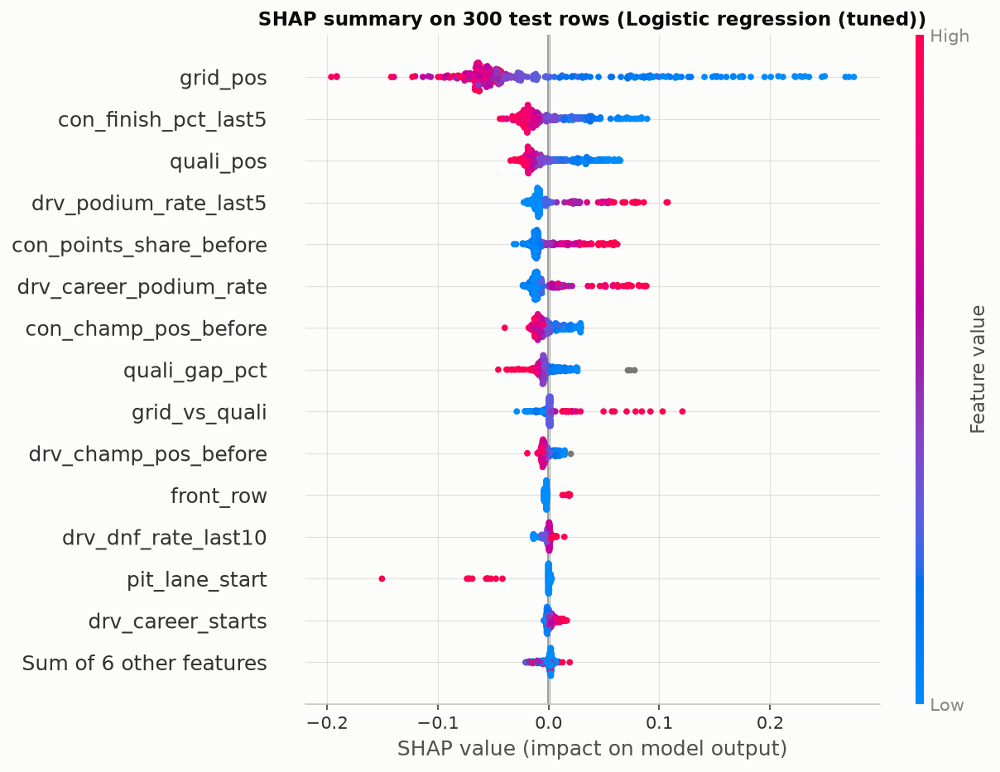

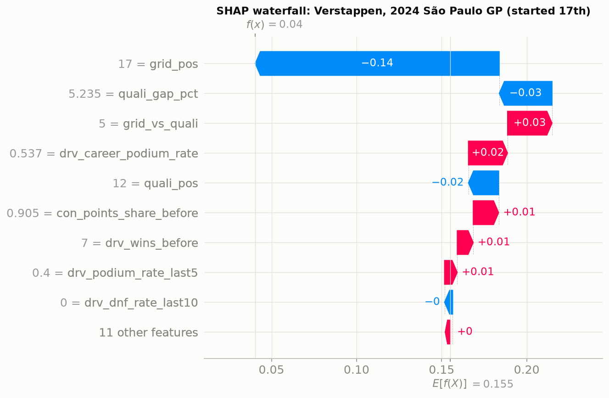

## 9. Inference function

`predict_podium(record)` takes a dictionary with any subset of the 20 features. It derives `front_row`, `grid_vs_quali` and `pit_lane_start` when possible, validates the inputs, imputes the missing ones inside the pipeline, and returns the probability, the decision at the validation threshold, and the list of missing inputs.

- **Complete record:** Verstappen, 2023 Japanese GP → P = 0.86, podium ✓.
- **Same record with its qualifying data removed:** P = 0.83, so the prediction degrades gracefully.
- **Very sparse records** are read as "debutant in round 1", because that is what missing form and standings meant in training. The function reports `n_missing_inputs` as a warning.

## 10. Limitations

1. **Qualifying-coverage drift.** No qualifying data before 1994, patchy data in 1996–2002, complete only from 2003. The training data mixes regimes with and without qualifying.
2. **Era sensitivity.** Reliability, field sizes, points systems and overtaking all changed; the grid-to-podium curve steepened over time. The 2022 rules are a distribution shift.
3. **Small evaluation sets** (117 and 204 podiums). The model differences are within noise, and selecting among many configurations inflates validation scores; the network's lucky seed is an example.
4. **Race-day events** (rain, safety cars, crashes, failures) are invisible before the start.
5. **Constructor renames** reset team history.
6. **Documented judgement calls:** the shared-drive rule, the population filters, pit-lane placement and the status grouping.
7. **The explanations are not causal.**
